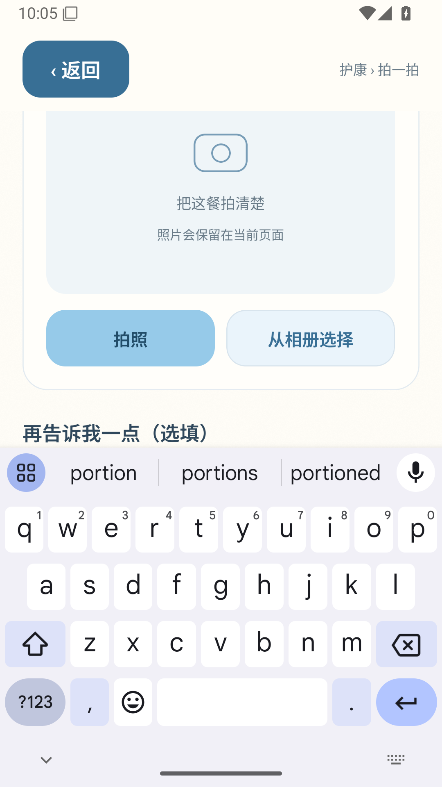
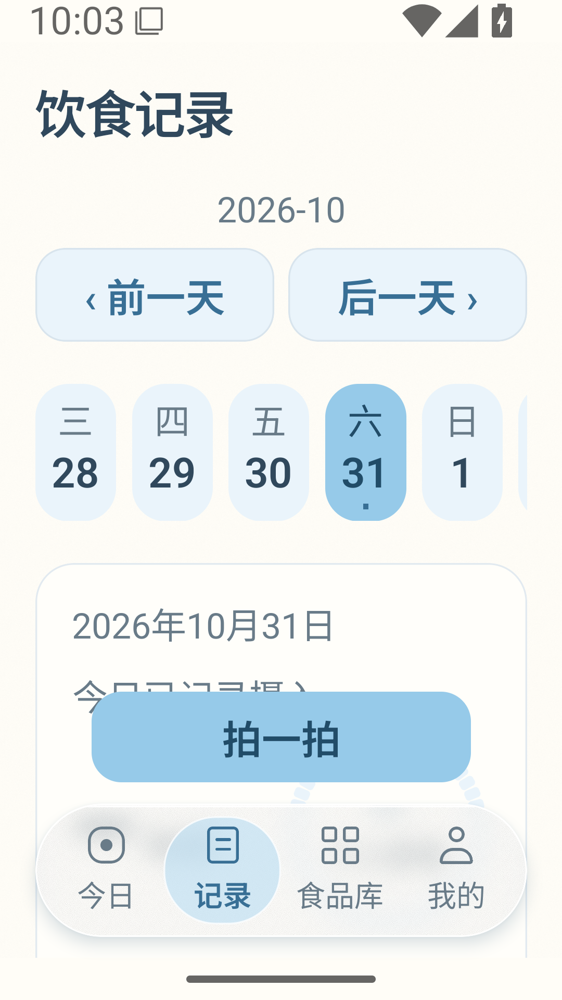

# 日期修复版的原生检查（非最终验收）

[运行 41190630319](https://github.com/chenchangxiang-330/Hukang-codex-China/actions/runs/41190630319) 的六组 UI 自动检查和离线完整业务均通过。同一 APK 重装后全部数据库表及图片哈希保持一致。测试使用 Android 15 模拟器，不是实体手机。

人工检查原始截图发现：键盘遮住餐食补充描述框，因此**整体 UI 验收不通过**。旧脚本只验证输入文字存在和保留，没有核对输入框与键盘的实际边界；保留原报告，不篡改自动化结果。

320dp / 系统字号 1.5 的日期按钮越界已修复：

[逐项观察与 ZIP 校验](visual-review.json) · [UI 自动报告](ui/nutrition-ui-v2/session.json) · [离线业务及同包覆盖安装](offline/session.json)。所有图片原样归档；正式饮食页保持空记录。后续键盘修复需要新的 APK 与原生复测。
