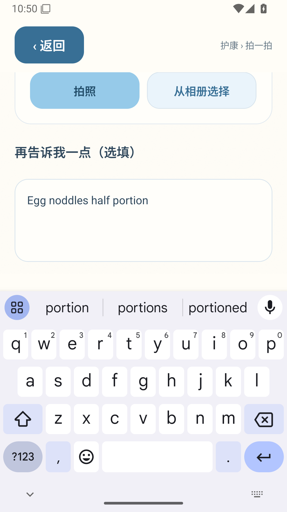

# 键盘修复包首次原生验收

[运行 41193660053](https://github.com/chenchangxiang-330/Hukang-codex-China/actions/runs/41193660053) 安装 APK 源码 `fd1b391bfa4d2a52c49a64f3851666a8b76a26fc`。

五组 UI 检查通过；键盘检查因系统窗口信息包含额外 `visibleFrame` 字段而匹配失败。原始报告保留，不改写为通过。对原始 XML 和窗口输出复核：输入框为 `[55,671][1025,982]`，键盘从 y=1092 开始，输入框已完整位于键盘上方。修正解析表达式后，只重跑页面验收，不重新构建 APK。

离线组首次失败发生在 APK 安装前：模拟器 adb 连接关闭。单独重试失败的离线任务；该环境失败不当作业务验证结果。

[原始报告](session.json) · [复核记录](review.json) · [Android 窗口信息](keyboard-window.txt)
