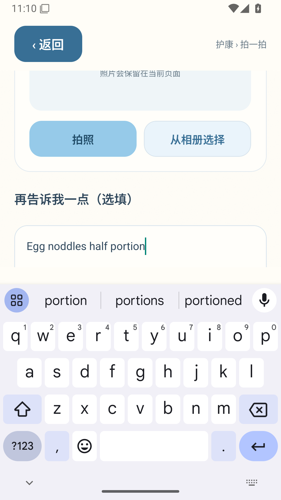
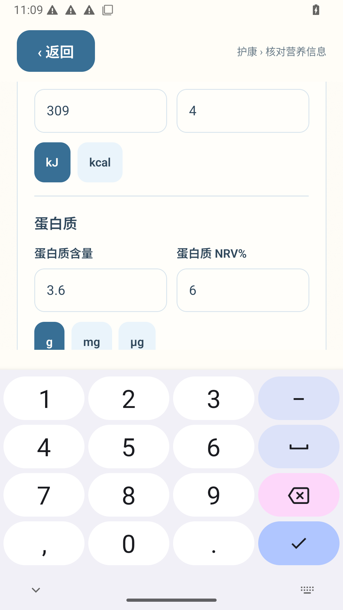

# Android 键盘复测失败证据

实际 ARM64 APK，Android 15 模拟器。正式饮食记录为空。以下是未修改的系统截图。

- [UI 复测](https://github.com/chenchangxiang-330/Hukang-codex-China/actions/runs/41195021926)：描述输入框只露出 161px，高度不足，自动边界检查失败。
- [离线复测](https://github.com/chenchangxiang-330/Hukang-codex-China/actions/runs/41193660053/job/124518856296)：能量、蛋白质核对后，脂肪输入框被键盘遮挡。
- 原始报告与窗口数据均保留；此前一次截图正常不能代表稳定通过。改用完整内容坐标计算滚动位置，并逐字段验证全框可见、稳定后才输入。

