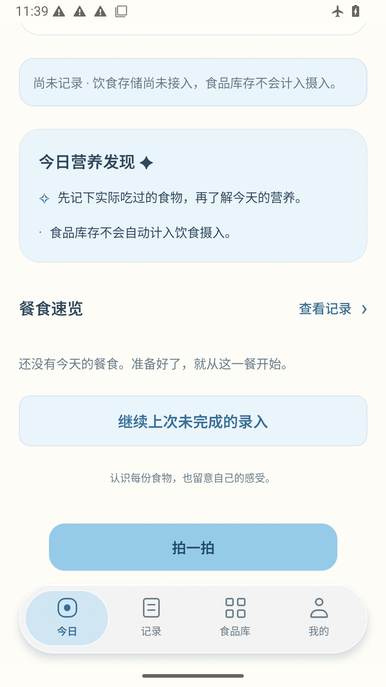

# Android 离线脚本返回动作修正

真实 APK 的商品名称输入框完整可见并已输入。下一字段之前，脚本依据输入法服务标志再次发送 Back，离开表单；原图为首页和可恢复草稿。改为以实际可见 IME 窗口决定是否需要返回，发送一次后等待键盘隐藏；不会重复返回页面。业务源码不变，复测同一 APK。

[运行](https://github.com/chenchangxiang-330/Hukang-codex-China/actions/runs/41197435291/job/124526341314) · [原始报告](session.json)

