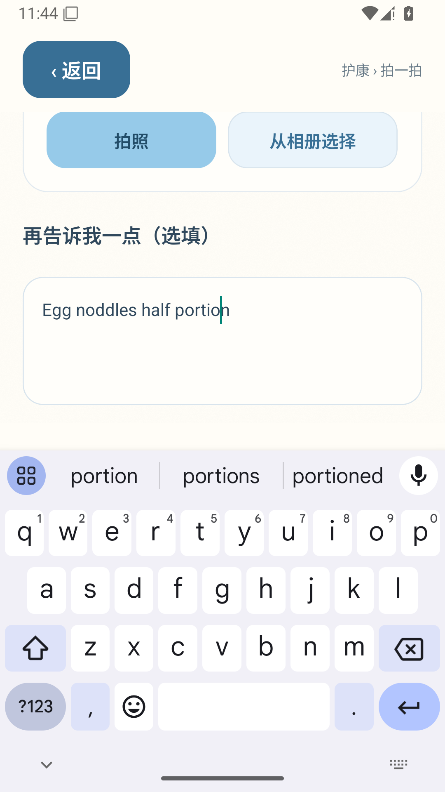

# Android 首次界面读取失败

第一组在首次启动读取 UI XML 时解析失败；后续营养展开、三种屏幕/字号、手势滚动、三次键盘开合及相机流程均通过。原始运行仍标记失败，不当作整组验收成功。脚本改为删除旧界面文件，每次获取新快照；无效内容保留，最多尝试三次，持续失败仍报错。业务源码不变，复测同一 APK。

[运行](https://github.com/chenchangxiang-330/Hukang-codex-China/actions/runs/41197435291/job/124526341108) · [原始报告](session.json)

