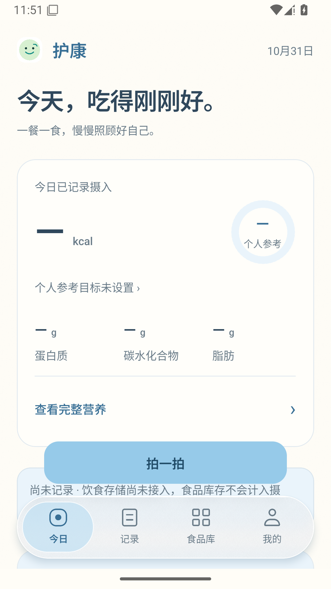
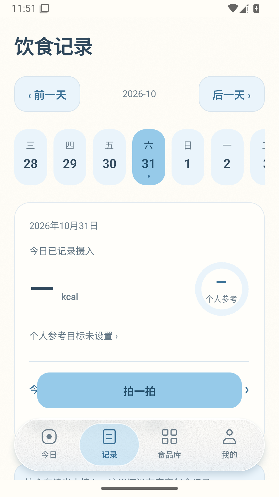
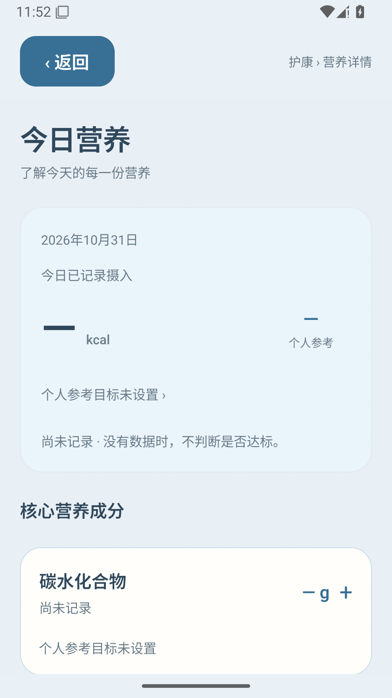

# Android 原生截图（模拟器）与执行证据

这些 PNG 来自实际安装 APK 的 Android 15 / API 35 模拟器，原样保存，未拼图、重绘或缩放。不是浏览器截图。

[ui 运行](https://github.com/chenchangxiang-330/Hukang-codex-China/actions/runs/41198423881/job/124529197841) · [offline 运行](https://github.com/chenchangxiang-330/Hukang-codex-China/actions/runs/41197876666/job/124527620082) · [原始证据 ZIP 1](https://github.com/chenchangxiang-330/Hukang-codex-China/actions/runs/41198423881/artifacts/13042480144) · [原始证据 ZIP 2](https://github.com/chenchangxiang-330/Hukang-codex-China/actions/runs/41197876666/artifacts/13041991140)

APK 源码 `aae421f0dc80635450b98206c9575dffaf7a82f7`，SHA-256 `7dd3fd4be1eb576cdd1c9275af3566b93df7d5db5a52506692380832d66fa3d8`。

UI 验收脚本 `11dff5d84704464880448208edf0d356c486c3dd`；离线脚本 `154225ea4e589ad11643870c7336df4e1b41a79b`。设备 `google/sdk_gphone64_x86_64/emu64xa:15/AE3A.240806.043/12960925:userdebug/dev-keys`，支持 ABI `x86_64,arm64-v8a`。

320 / 390 表示 Android 实际显示密度对应的逻辑宽度；font150 表示系统 font_scale=1.5。PNG 本身是 1080×1920 物理像素。

首页、饮食记录和营养详情始终没有演示饮食记录。离线业务验收随后在独立模拟器内通过真实 OCR 和人工核对录入 Test Milk 食品与库存；它不算饮食摄入。

离线组早期 home / mine / scanner 原图含模拟器禁用 Google 服务后的系统通知，原样保留；它不是护康的提示。主页面布局验收以 nutrition-ui-v2 目录的独立 UI 组原图为准。

| 原生检查 | 结果 |
| --- | --- |
| navigation-empty | passed |
| nutrition-accordions-date | passed |
| small-screen-system-font | passed |
| gesture-safe-area | passed |
| keyboard-state | passed |
| camera-permissions | passed |

离线核心流程：图片条码解码、草稿恢复、真实离线 OCR、旋转裁剪后识别、五项人工核对与单位纠正、食品保存与复扫命中、分别入库与库存消耗、编辑保留原文及修订、三种导出及原图哈希核对。同 APK 覆盖重装后所有数据库表及原图哈希保持一致；未验证旧签名包的升级。

相机照片来自 Android 模拟器虚拟场景，未声称手机镜头/对焦/光照或实物条码扫描已通过。英文键盘已执行，中文输入法和厂商系统仍需手机核对。

## 空数据页面

### 今天

### 饮食记录

### 今日营养

## 全部截图

| 截图 | 原始文件 |
| --- | --- |
| actual-catalogue-share-sheet | [PNG](actual-catalogue-share-sheet.png) |
| actual-catalogue-with-photos-share-sheet | [PNG](actual-catalogue-with-photos-share-sheet.png) |
| actual-personal-with-photos-share-sheet | [PNG](actual-personal-with-photos-share-sheet.png) |
| crop-modal-before-drag | [PNG](crop-modal-before-drag.png) |
| crop-selected | [PNG](crop-selected.png) |
| draft-resumed | [PNG](draft-resumed.png) |
| edited-product | [PNG](edited-product.png) |
| home | [PNG](home.png) |
| inventory-reduced | [PNG](inventory-reduced.png) |
| inventory | [PNG](inventory.png) |
| mine | [PNG](mine.png) |
| android-ai-unavailable-feedback | [PNG](nutrition-ui-v2/android-ai-unavailable-feedback.png) |
| android-camera-permission-denied | [PNG](nutrition-ui-v2/android-camera-permission-denied.png) |
| android-camera-permission-request | [PNG](nutrition-ui-v2/android-camera-permission-request.png) |
| android-capture-empty-photo-feedback | [PNG](nutrition-ui-v2/android-capture-empty-photo-feedback.png) |
| android-capture-keyboard-repeat1 | [PNG](nutrition-ui-v2/android-capture-keyboard-repeat1.png) |
| android-capture-keyboard-repeat2 | [PNG](nutrition-ui-v2/android-capture-keyboard-repeat2.png) |
| android-capture-keyboard | [PNG](nutrition-ui-v2/android-capture-keyboard.png) |
| android-capture-meal-empty | [PNG](nutrition-ui-v2/android-capture-meal-empty.png) |
| android-capture-package-empty | [PNG](nutrition-ui-v2/android-capture-package-empty.png) |
| android-captured-meal-original-photo | [PNG](nutrition-ui-v2/android-captured-meal-original-photo.png) |
| android-captured-package-original-photo | [PNG](nutrition-ui-v2/android-captured-package-original-photo.png) |
| android-diary-320-empty | [PNG](nutrition-ui-v2/android-diary-320-empty.png) |
| android-diary-320-font150-empty | [PNG](nutrition-ui-v2/android-diary-320-font150-empty.png) |
| android-diary-390-empty | [PNG](nutrition-ui-v2/android-diary-390-empty.png) |
| android-diary-390-font150-empty | [PNG](nutrition-ui-v2/android-diary-390-font150-empty.png) |
| android-diary-scroll-end-gesture-safe-area | [PNG](nutrition-ui-v2/android-diary-scroll-end-gesture-safe-area.png) |
| android-library-390-empty | [PNG](nutrition-ui-v2/android-library-390-empty.png) |
| android-live-barcode-scanner | [PNG](nutrition-ui-v2/android-live-barcode-scanner.png) |
| android-mine-390-empty | [PNG](nutrition-ui-v2/android-mine-390-empty.png) |
| android-nutrition-320-empty | [PNG](nutrition-ui-v2/android-nutrition-320-empty.png) |
| android-nutrition-320-font150-empty | [PNG](nutrition-ui-v2/android-nutrition-320-font150-empty.png) |
| android-nutrition-390-empty | [PNG](nutrition-ui-v2/android-nutrition-390-empty.png) |
| android-nutrition-390-font150-empty | [PNG](nutrition-ui-v2/android-nutrition-390-font150-empty.png) |
| android-nutrition-carbohydrate-empty | [PNG](nutrition-ui-v2/android-nutrition-carbohydrate-empty.png) |
| android-nutrition-fat-empty | [PNG](nutrition-ui-v2/android-nutrition-fat-empty.png) |
| android-nutrition-fiber-empty | [PNG](nutrition-ui-v2/android-nutrition-fiber-empty.png) |
| android-nutrition-from-selected-diary-date | [PNG](nutrition-ui-v2/android-nutrition-from-selected-diary-date.png) |
| android-nutrition-minerals-empty | [PNG](nutrition-ui-v2/android-nutrition-minerals-empty.png) |
| android-nutrition-protein-empty | [PNG](nutrition-ui-v2/android-nutrition-protein-empty.png) |
| android-nutrition-scroll-end-320-font150 | [PNG](nutrition-ui-v2/android-nutrition-scroll-end-320-font150.png) |
| android-nutrition-scroll-end-320 | [PNG](nutrition-ui-v2/android-nutrition-scroll-end-320.png) |
| android-nutrition-scroll-end-390-font150 | [PNG](nutrition-ui-v2/android-nutrition-scroll-end-390-font150.png) |
| android-nutrition-vitamins-empty | [PNG](nutrition-ui-v2/android-nutrition-vitamins-empty.png) |
| android-nutrition-water-empty | [PNG](nutrition-ui-v2/android-nutrition-water-empty.png) |
| android-system-camera-virtual-scene | [PNG](nutrition-ui-v2/android-system-camera-virtual-scene.png) |
| android-today-320-empty | [PNG](nutrition-ui-v2/android-today-320-empty.png) |
| android-today-320-font150-empty | [PNG](nutrition-ui-v2/android-today-320-font150-empty.png) |
| android-today-390-empty | [PNG](nutrition-ui-v2/android-today-390-empty.png) |
| android-today-390-font150-empty | [PNG](nutrition-ui-v2/android-today-390-font150-empty.png) |
| android-today-gesture-safe-area | [PNG](nutrition-ui-v2/android-today-gesture-safe-area.png) |
| ocr-review-before-corrections | [PNG](ocr-review-before-corrections.png) |
| review-fat-keyboard | [PNG](review-fat-keyboard.png) |
| review | [PNG](review.png) |
| scanner | [PNG](scanner.png) |

[每个文件的 SHA-256 与像素尺寸](manifest.json) · [原生 UI 执行报告](nutrition-ui-v2/session.json) · [离线业务及覆盖重装报告](session.json)

[浏览器截图另见独立目录](../../browser/README.md)。浏览器相机、OCR、SQLite 为替身，不计入 Android 验收。
