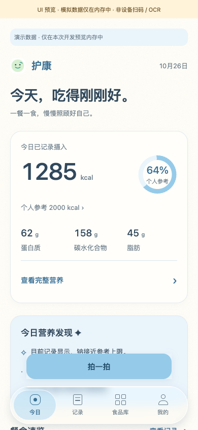
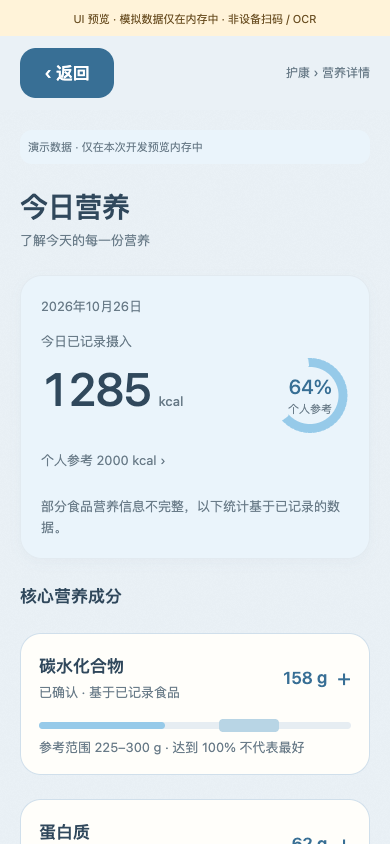
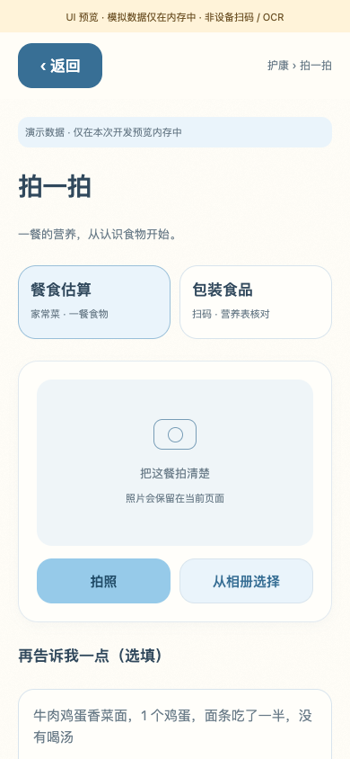

# 浏览器截图（React Native Web）

2026-10-31，Chrome / React Native Web，生产 `SimpleAppView` 与 RN 页面组件。相机、OCR、SQLite、原 controller 在浏览器中由明确的开发测试替身替换。不是 Android 设备实测，不是单独绘制的 HTML 设计图。

[Android 实际安装 APK 的原生截图（模拟器）](../android/verified/README.md) 单独归档。

- 营养交互：25 项检查、22 张截图，见 [报告](nutrition/report.json)。
- 原界面回归：34 项检查、22 张截图，见 [报告及源文件 SHA-256](regression/report.json)。
- 尺寸：320×760 和 390×844；所有截图原尺寸、未重绘。顶部黄色条明确标记浏览器模拟边界，页面中的蓝条标记演示数据。
- 正式空数据入口没有示例食品或 2000 kcal 默认目标。有数据截图来自仅在开发预览存在的内存适配器。
- 大字体截图是浏览器近似检查，不等于 Android 系统字体、键盘、TalkBack 或安全区验收。

| 场景 | 390 dp | 320 dp |
| --- | --- | --- |
| 今天 | [截图](nutrition/today-390.png) | [截图](nutrition/today-320.png) |
| 正式空数据首页 | [截图](nutrition/today-empty-390.png) | [截图](nutrition/today-empty-320.png) |
| 饮食记录 | [截图](nutrition/diary-390.png) | [截图](nutrition/diary-320.png) |
| 今日营养 | [截图](nutrition/nutrition-390.png) | [截图](nutrition/nutrition-320.png) |
| 营养缺失 | [截图](nutrition/nutrition-missing-390.png) | [截图](nutrition/nutrition-missing-320.png) |
| 添加糖未知与双参考线 | [截图](nutrition/nutrition-added-sugar-390.png) | [截图](nutrition/nutrition-added-sugar-320.png) |
| 餐食估算入口 | [截图](nutrition/capture-meal-390.png) | [截图](nutrition/capture-meal-320.png) |
| 餐食估算结果 | [截图](nutrition/meal-result-390.png) | [截图](nutrition/meal-result-320.png) |
| 包装食品入口 | [截图](nutrition/capture-package-390.png) | [截图](nutrition/capture-package-320.png) |
| 包装结果、每份/整包不同 | [截图](nutrition/package-result-390.png) | [截图](nutrition/package-result-320.png) |

[添加糖已知小计超限](nutrition/added-sugar-exceeded-390.png) · [大字体近似](nutrition/today-fontscale-320.png)

