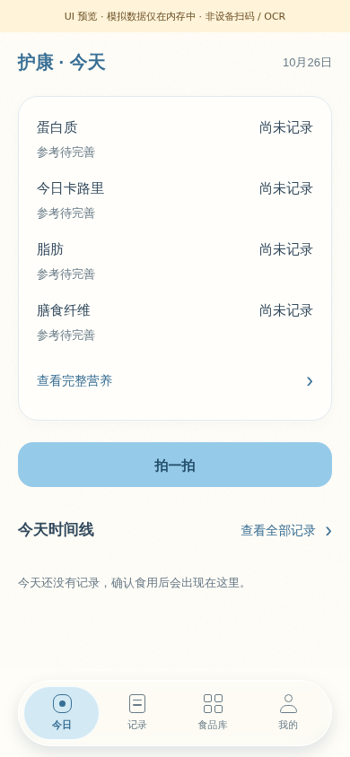
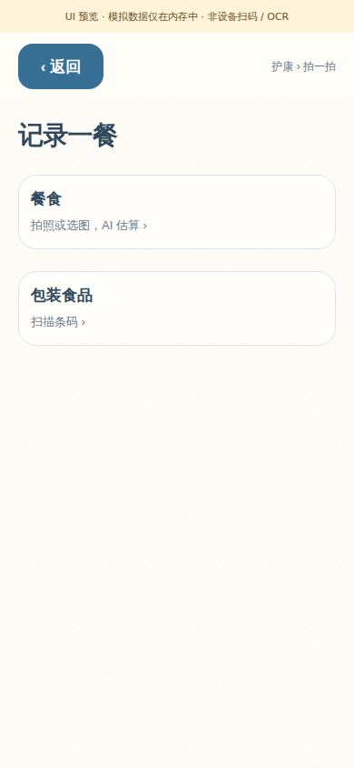

# 浏览器预览（不是 Android 截图）

共享 React Native 页面由 React Native Web 渲染。相机、SQLite、Keystore 为测试适配器，AI 为隔离模拟 HTTP；未访问真实服务商，也不向正式 App 写记录。

- 首页/营养详情/拍一拍：真实空数据形态见 `browser-home-empty.png`、`browser-nutrition-minerals.png`、`browser-two-entries.png`、`browser-meal-photo-required.png`。
- 隔离测试数据：`browser-portion-preview.png`、`browser-320-protein-partial.png`、`browser-target-draft.png`、`review.png`。测试目标不是用户默认目标。
- 连接页为模拟连接；截图密钥为空。`browser-saved-connection.png` 不证明真实提供商或 Android 安全存储已通过。
- 34 项离线共享界面、8 项营养界面检查及 AI 模拟流程报告附在本目录。截图 SHA-256 见 `files.json`。原生证据单独保存在相邻 Android 目录。

